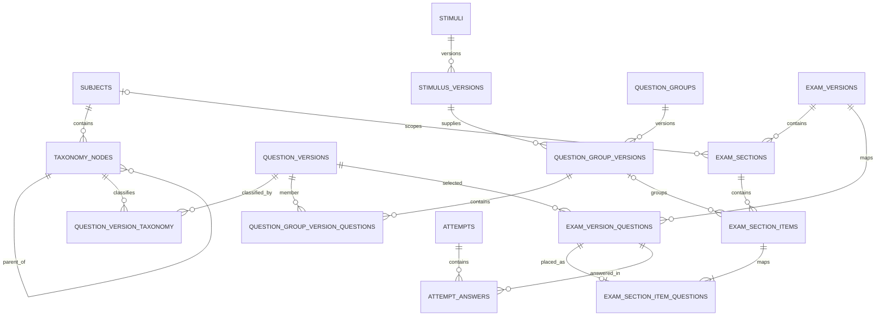

# Multi-subject assessment platform — architecture specification

Status: Proposed architecture; documentation-only foundation phase  
Decision owner: Product owner  
Implementation status: No Production schema or data has been changed.

## 1. Accepted product decisions

- One unified platform serves Mathematics, Reading Comprehension, Science, and future subjects.
- Automatic grading is the first priority. Constructed-response and essay grading are deferred until rubric and review workflows are ready.
- Stimuli are independent, versioned, reusable content objects.
- Published exam versions and submitted attempts remain historically stable.
- Existing exam/question/attempt identifiers and the attempt-answer foreign-key path remain intact during migration.

## 2. Non-negotiable invariants

1. A question identity (`questions.id`) is not a question version (`question_versions.id`).
2. A published exam is a versioned composition of immutable question versions and immutable stimulus versions.
3. Every question rendered in an exam has exactly one `exam_version_questions.id`. This identifier remains the key used by `attempt_answers`, question-time tracking, and existing answer-save RPCs.
4. Grouping questions changes presentation and navigation, not the identity of the answerable question.
5. Answer keys remain server-side. Student-facing RPCs must never return answer keys, explanations reserved for review, grading metadata, or private source metadata before submission.
6. New tables use RLS and explicit grants. A missing direct student policy is intentional only when access is mediated by a reviewed SECURITY DEFINER RPC.
7. No destructive rename, drop, type rewrite, or bulk content conversion is part of the foundation migration.
8. A migration is not considered safe solely because it applies. It must pass clean-install, legacy-contract, RLS, and end-to-end regression tests.

## 3. Current schema contracts to preserve

The live system currently has the following relevant entities:

- `exams`, `exam_versions`
- `questions`, `question_versions`, `question_answer_keys`
- `exam_version_questions`
- `attempts`, `attempt_answers`
- `attempt_question_times`, `attempt_question_time_events`
- `profiles`, `audit_logs`
- `import_jobs`, `import_questions`, `import_events`

Observed live data at architecture review: 119 question identities, 231 question versions, 231 answer-key rows, 318 exam-question mappings, 15 attempts, and 16 attempt-answer rows. These are a point-in-time baseline, not constants.

Important constraints:
- `question_versions` and `question_answer_keys` have immutability triggers. Existing question versions must not be updated to attach a stimulus; create a new version when the content/stimulus relationship changes.
- `exam_versions` and `exam_version_questions` are protected after publication. New section/group tables must implement equivalent draft-only mutation rules.
- `question_versions.question_type` currently allows only `mc`, `ms`, `tf`, `num`, and `dnd`.
- `question_versions.content` must be a JSON object containing `q`; the current centralized validator additionally requires `o` to be an array for all five existing types. New types such as fill-in and constructed response require per-type content schemas rather than a global `o` requirement.
- `exam_version_questions` has unique question position per exam version and unique question-version membership per exam version.
- `attempt_answers` is tied to both `attempts` and `exam_version_questions` through composite foreign keys that include `exam_version_id`.
- `attempts` retains the exact exam version used for the attempt.
- `get_published_exam` returns a flat `questions` array; the legacy exam runtime consumes this contract.
- `admin_save_exam_content` accepts a flat `p_questions` JSON array and owns the legacy save/reconcile behavior.
- `submit_exam_attempt` grades from `exam_version_questions` and writes authoritative scores to `attempt_answers` and `attempts`.

The new architecture must wrap these contracts before replacing any of them.

All 231 observed question versions currently have a string prompt and an options array; none has a detected `stimulus` property. Existing content should not be reinterpreted or bulk-converted. The import staging tables currently store question content and answer keys but do not model reusable stimulus/group entities, so import-pipeline support must be added in a later phase.

## 4. Target domain model

### 4.1 Subject and taxonomy

#### `subjects`
Suggested columns:
- `id uuid primary key`
- `code text not null unique` — stable machine identifier such as `mathematics`, `reading`, `science`
- `name text not null`
- `description text`
- `is_active boolean not null default true`
- `display_order integer not null default 0`
- `created_at`, `updated_at`

Subject codes are stable API identifiers. Display names may be localized.

#### `taxonomy_nodes`
Suggested columns:
- `id uuid primary key`
- `subject_id uuid not null references subjects(id)`
- `parent_id uuid null references taxonomy_nodes(id)`
- `node_type text not null` — controlled values such as `domain`, `topic`, `skill`, `competency`
- `code text not null`
- `name text not null`
- `description text`
- `display_order integer not null default 0`
- `is_active boolean not null default true`

Rules:
- A parent and child must belong to the same subject.
- Cycles are forbidden.
- Use recursive queries over `parent_id`; do not store a denormalized path as the source of truth.
- Unique code scope must be explicit (at minimum subject + parent + code).
- Taxonomy is editable, but historical analytics must retain the classification that applied to the question version or exam snapshot.

#### `question_version_taxonomy`
Many-to-many relation:
- `question_version_id` references `question_versions(id)`
- `taxonomy_node_id` references `taxonomy_nodes(id)`
- `relation_type` distinguishes primary topic, secondary topic, skill, or competency
- optional `weight numeric` only if a future reporting requirement justifies weighted attribution
- composite primary key and indexes in both lookup directions

Attach classification to question versions rather than only question identities. This preserves historical classification when an editor changes the intended skill of a later question version.

### 4.2 Independent reusable stimuli

#### `stimuli`
Stable identity and lifecycle metadata only:
- `id uuid primary key`
- `status text` (draft/active/archived; exact lifecycle to be finalized)
- `created_by uuid`
- timestamps

#### `stimulus_versions`
Immutable content versions:
- `id uuid primary key`
- `stimulus_id uuid not null references stimuli(id)`
- `version_no integer not null check > 0`
- `stimulus_type text not null` (text/table/chart/image/dataset/experiment/mixed)
- `content jsonb not null`
- `metadata jsonb not null default '{}'`
- `created_by uuid`
- `created_at timestamptz`
- unique (`stimulus_id`, `version_no`)

Content is structured JSON with a versioned schema. Large files are stored in Supabase Storage and referenced by opaque asset IDs/paths; binary data is never embedded in JSONB. The current `tsa-imports` bucket is private, has a 25 MiB limit, and has no MIME allowlist. Do not reuse it for stimulus media: create a dedicated private stimulus bucket with explicit MIME/size policy and controlled signed access in the storage phase. Bucket creation is not part of this architecture-only PR.

A stimulus version referenced by a published exam cannot be edited or deleted. Corrections create a new version.

#### Question-to-stimulus association
Add nullable `question_versions.stimulus_version_id` only in a later migration after a question-version immutability review. It supports standalone questions that refer to one stimulus. A group-level stimulus remains attached to `question_group_versions`. The API must define precedence and must not silently display two conflicting shared stimuli.

### 4.3 Question groups

#### `question_groups`
Stable group identity, lifecycle, creator, timestamps.

#### `question_group_versions`
- `id uuid primary key`
- `question_group_id uuid not null`
- `version_no integer not null`
- `stimulus_version_id uuid not null references stimulus_versions(id)`
- `instructions text`
- `metadata jsonb not null default '{}'`
- unique (`question_group_id`, `version_no`)

#### `question_group_version_questions`
- `question_group_version_id uuid not null`
- `question_version_id uuid not null references question_versions(id)`
- `position integer not null check > 0`
- primary key (`question_group_version_id`, `question_version_id`)
- unique (`question_group_version_id`, `position`)

Membership is versioned. Editing group membership creates a new group version; it does not mutate a group already used by a published exam.

A group can contain mixed question types. Scoring remains per question.

### 4.4 Exam sections and ordered items

#### `exam_sections`
- `id uuid primary key`
- `exam_version_id uuid not null references exam_versions(id)`
- optional `subject_id uuid references subjects(id)`
- `title text not null`
- `instructions text`
- optional `duration_seconds integer check > 0`
- `position integer not null check > 0`
- unique (`exam_version_id`, `position`)

A section may be subject-specific or mixed. If subject-specific, all its question versions must be classified consistently or explicitly marked as cross-subject.

#### `exam_section_items`
Represents a top-level item in a section:
- `id uuid primary key`
- `section_id uuid not null references exam_sections(id)`
- `item_type text not null check in ('question','group')`
- `question_group_version_id uuid null references question_group_versions(id)`
- `position integer not null check > 0`
- unique (`section_id`, `position`)
- CHECK: question item has no group version; group item has exactly one group version.

#### `exam_section_item_questions`
Maps top-level items to the existing answerable exam-question mappings:
- `section_item_id uuid not null references exam_section_items(id)`
- `exam_version_question_id uuid not null references exam_version_questions(id)`
- `position integer not null check > 0`
- primary key (`section_item_id`, `exam_version_question_id`)
- unique (`exam_version_question_id`) so a mapping cannot appear twice in the same exam structure
- unique (`section_item_id`, `position`)

For a question item, exactly one child mapping is required. For a group item, one or more child mappings are required and their question versions must match the ordered membership in the referenced group version. Enforce these cross-row invariants in a single admin RPC and deferred/constraint-trigger validation; ordinary CHECK constraints cannot validate child-row cardinality or cross-table membership.

This model deliberately retains `exam_version_questions` as the authoritative per-question exam mapping. It avoids breaking `attempt_answers` and timing tables.

### 4.5 Grading

Keep `question_answer_keys` server-side. The current five types remain supported and are the baseline compatibility contract.

A later grading refactor should separate:
- answer normalization
- type-specific validation
- type-specific scoring
- grading configuration
- result serialization

Persist the grading strategy/version used for each published question version or exam mapping before adding scoring algorithms that may change. Historical attempts must not be silently regraded when a scoring algorithm is updated.

Constructed-response grading is deferred. Future tables may include rubric identities/versions and review records, but no AI-generated score becomes authoritative without an explicit human-review policy.

## 5. RPC and application contracts

Do not mutate the old RPC response in place during the transition.

Retain:
- `get_published_exam` with its current flat shape for the legacy runtime.
- `admin_get_exam_version` and `admin_save_exam_content` for the current editor until a replacement is parity-tested.
- existing answer-save, time tracking, resume, submit, and history RPCs.

Introduce versioned contracts:
- `get_published_exam_v2`: returns sections, ordered top-level items, group stimuli, and question payloads. It returns no answer keys or grading metadata.
- `admin_get_exam_structure_v2`: admin-only structured editor payload, including answer keys.
- `admin_save_exam_structure_v2`: transactional save/reconcile of sections, group instances, and question mappings; draft-only.
- optional `admin_save_stimulus_version` and group authoring RPCs after RLS design.

The v2 payload should normalize all items into a typed structure. The frontend should not reconstruct domain relationships through multiple direct table reads.

A compatibility adapter may flatten v2 sections to the legacy `questions` array for old exam clients, but this is a one-way presentation adapter; it must not discard group/stimulus structure when saving.

## 6. Security model

- Enable RLS on every new table.
- Admin writes are guarded by both RLS/grants and explicit `public.is_admin()` checks inside SECURITY DEFINER RPCs.
- Student-facing content access goes through a reviewed RPC that filters to published exam versions and returns only public stimulus/question fields.
- No direct student SELECT on `question_answer_keys`, rubric keys, import staging internals, or private stimulus metadata.
- SECURITY DEFINER functions use `SET search_path = ''` and schema-qualified references.
- Storage uploads validate owner/admin, MIME type, size, and allowed object path. Avoid a public bucket for private source files.
- Audit authoring, publishing, archiving, and stimulus-version changes.

## 7. Versioning and deletion policy

- Question version, stimulus version, and question-group version are immutable once referenced by a published exam.
- A published exam version is immutable.
- A new exam version is created for structural/content changes.
- Referenced versions use RESTRICT semantics; archival is preferred to deletion.
- Deleting a draft may cascade only through draft-owned structures and only after checking no attempt or published exam references exist.
- Attempt rows and answer rows are retained according to the existing retention policy; no migration in this project deletes historical attempts.

## 8. Implementation phases

1. P0: audit and approve data model, invariants, legacy contracts, RLS matrix, and migration sequence.
2. P1: additive subject/taxonomy/stimulus schema; no conversion of existing questions.
3. P2: group versioning and section/item structure; backfill existing exam mappings to one default section without changing mapping IDs.
4. P3: v2 read/write RPCs and compatibility adapters.
5. P4: question type registry and grading abstraction; preserve the five current types.
6. P5: admin authoring UI, then exam runtime group rendering.
7. P6: Reading and Science content rollout.
8. P7: analytics and constructed-response/rubric workflow.

Each phase has its own PR and must pass its own gates. Do not combine the entire restructuring into one mega-migration.

## 9. ERD overview

The ERD shows ownership and conceptual cardinality. Exact SQL foreign keys, including composite keys that bind a mapping to the same exam version as an attempt, must be specified in the migration design and verified against PostgreSQL catalogs.

## 10. Initial RLS matrix

| Resource | Admin | Student | Anonymous |
|---|---|---|---|
| Subjects and taxonomy | CRUD through admin RPC | Published metadata through read RPC | No direct table access |
| Stimulus identities/versions | CRUD through admin RPC | Only stimulus versions referenced by a published exam, through read RPC | No access |
| Question groups and group versions | CRUD through admin RPC | Only through published exam read RPC | No access |
| Question-group membership | CRUD through admin RPC | Only through published exam read RPC | No access |
| Exam sections and items | CRUD on draft through admin RPC | Published structure through read RPC | No access |
| Question-version taxonomy | CRUD through admin RPC | Aggregated analytics only through authorized RPC | No access |
| Question answer keys | Existing admin-only workflow | No direct access; result details only after submission | No access |
| Storage assets | Admin upload/manage | Access only if referenced by a published exam and policy permits | No access by default |

Use explicit grants and RLS together. Prefer no direct student table policies for content whose visibility depends on publication state, unless a policy has been proven equivalent to the reviewed RPC filter. Every SECURITY DEFINER RPC must enforce caller role and publication state itself.

## 11. Cross-table invariants that require transactional enforcement

The following cannot be guaranteed by ordinary row-level CHECK constraints alone:
- A taxonomy parent belongs to the same subject and the hierarchy contains no cycle.
- A question-group version contains at least one question and each member position is unique.
- A group item contains exactly the question mappings in its referenced group version, in the same order.
- A standalone question item contains exactly one mapping.
- Every exam mapping is placed exactly once in the section tree.
- The section tree belongs to the same exam version as every mapping it contains.

Enforce these rules in the structured admin RPC inside a transaction, with supporting unique/FK constraints and deferred constraint triggers where appropriate. Do not rely on frontend validation.
